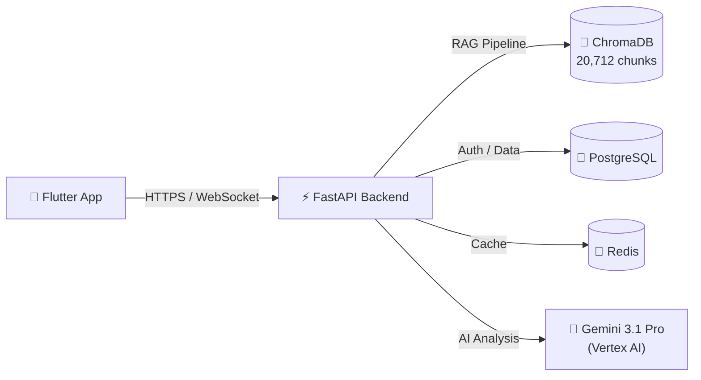

# კანონის ოსტატი — The Master of Law

> AI-powered legal advocate for Georgian citizens. Case-centric architecture.

The law exists to protect everyone — but in practice, it's buried in dense codes, scattered across court rulings, and written in language that shuts ordinary people out. **The Master of Law** puts the full weight of Georgian law — statutes, Supreme Court practice, Grand Chamber decisions — into the hands of the people who need it most, when they need it most.

This is not a legal search engine. This is a legal advocate. Every feature we build must pass one test: **does this help a real person win a real case?**

---

## Features

- 🤖 **AI Legal Consultation** — Describe your situation in plain Georgian; get structured legal analysis with citations
- ⚖️ **Multi-Source RAG** — Searches 12 legal codes + 5,197 Supreme Court rulings + 177 Grand Chamber decisions
- 📁 **Defense Case Builder** — Generate structured 8-section case files from conversations
- 🔍 **Law Browser** — Browse and search all Georgian laws (free, unlimited)
- 💬 **Streaming Chat** — Real-time WebSocket responses for immediate feedback
- 🌐 **Georgian First** — Full Georgian language support with English fallback
- 🔐 **Secure** — Firebase Authentication, tier-based rate limiting, credit-based access control

---

## Quick Start

Get the backend running and Flutter app building in ~30 minutes:

📖 **[Quick Start Guide →](docs/QUICKSTART.md)**

```bash
# Backend (Docker)
cd backend && docker compose up -d --build
docker compose exec api alembic upgrade head
curl http://127.0.0.1:8000/api/v1/health

# Flutter
cd frontend && flutter pub get && flutter run
```

---

## Architecture



- **Frontend:** Flutter 3.32+ (package: `themasteroflaw`, bundle: `ge.fuzzycore.masteroflaw`)
- **Backend:** FastAPI + SQLAlchemy (async) + PostgreSQL 16 + Redis 7
- **RAG:** 5-stage pipeline — Query Expansion → Vector Search → Full-Text Search → Merge/Dedup → Gemini Rerank
- **AI:** Gemini 3.1 Pro for legal analysis, `gemini-embedding-001` (768-dim) for retrieval
- **Vector Store:** ChromaDB with 3 collections (georgian_laws, court_practice, grand_chamber)

📖 **[Full Architecture →](docs/ARCHITECTURE.md)**

---

## Documentation

| Document | Purpose |
|----------|---------|
| [docs/QUICKSTART.md](docs/QUICKSTART.md) | Zero-to-running in 30 minutes |
| [docs/ARCHITECTURE.md](docs/ARCHITECTURE.md) | System design, data flow, decision logs |
| [docs/API.md](docs/API.md) | Complete API reference with curl examples |
| [docs/DEVELOPMENT.md](docs/DEVELOPMENT.md) | Contributing guide, code style, debugging |
| [docs/LAW_CORPUS.md](docs/LAW_CORPUS.md) | Legal data documentation and pipeline |
| [.agents/context/production.md](.agents/context/production.md) | Production deployment guide |

---

## Project Status

| Component | Status |
|-----------|--------|
| Law Corpus (20,712 chunks, 3 collections) | ✅ Complete |
| Backend (27 endpoints, 10 services, 124+ tests) | ✅ Complete |
| Eval Pipeline (50 real Supreme Court cases) | ✅ Complete |
| Design System | 🔄 In Progress |
| Flutter App | 🔄 In Progress |

---

## Contributing

We welcome contributors! Please read our [Development Guide](docs/DEVELOPMENT.md) for:
- Code style and conventions
- How to add endpoints, services, and models
- Git workflow and commit conventions
- How to run tests and the eval pipeline

### Quick Commands

```bash
# Run backend tests
cd backend && .venv/bin/python -m pytest tests/ -v

# Run Flutter tests
cd frontend && flutter test

# Run eval pipeline
python3 eval/test_cases/run_eval.py --limit 3
```

---

## License

TBD — Legal data sourced from [matsne.gov.ge](https://matsne.gov.ge) (public government portal).

---

<p align="center">
  
  
  
  
  
</p>
