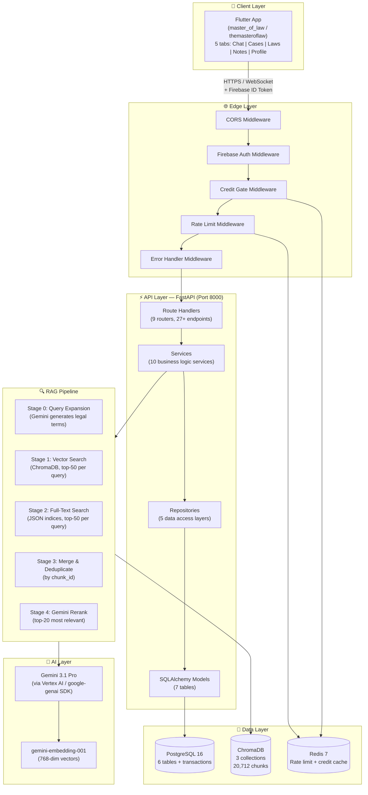
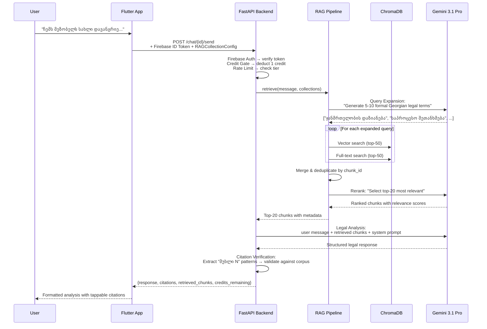
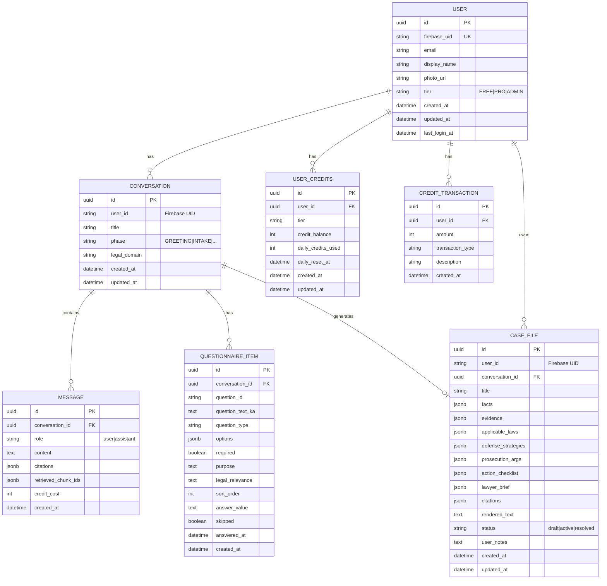
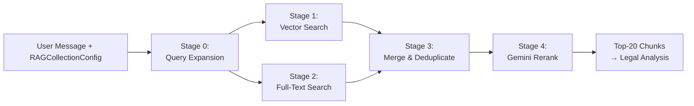
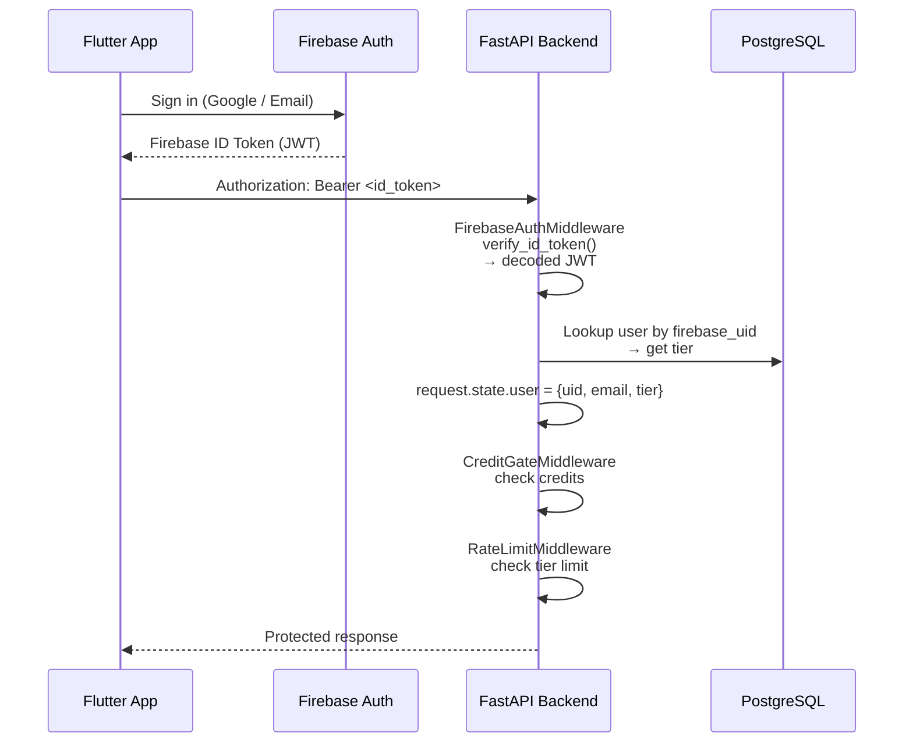

# Architecture Documentation

> **Last updated:** 2026-05-09

---

## High-Level System Diagram



---

## Data Flow: User → Response



---

## Backend Layer Architecture

```
Route (thin) → Service (logic) → Repository (DB) → Model (ORM)
```

### Philosophy

- **Routes** handle HTTP concerns only: parsing requests, calling services, returning responses. Max 15 lines.
- **Services** contain all business logic. Singleton pattern. Never import SQLAlchemy.
- **Repositories** contain all database queries. One per model. Inject `AsyncSession`.
- **Models** are pure SQLAlchemy ORM definitions. One model per file.

### Example: Adding a new endpoint

See [`DEVELOPMENT.md`](./DEVELOPMENT.md) for the full workflow. The dependency chain is:

```python
# Route depends on Service
@router.post("/example")
async def example_endpoint(db: AsyncSession = Depends(get_db)):
    svc = MyService(db)  # Service receives db, creates Repository internally
    result = await svc.do_something()
    return result

# Service depends on Repository
class MyService:
    def __init__(self, db: AsyncSession):
        self.repo = MyRepository(db)

    async def do_something(self):
        return await self.repo.find_all()

# Repository depends on Model
class MyRepository:
    def __init__(self, db: AsyncSession):
        self.db = db

    async def find_all(self):
        result = await self.db.execute(select(MyModel))
        return result.scalars().all()
```

---

## Database Schema



### Table Summary

| Table | Purpose | Key Columns |
|-------|---------|-------------|
| `users` | Synced from Firebase Auth | `firebase_uid` (unique), `tier` |
| `user_credits` | Credit balance per user | `credit_balance`, `daily_credits_used`, `daily_reset_at` |
| `credit_transactions` | Audit log of all credit changes | `amount` (±), `transaction_type` |
| `conversations` | Chat sessions | `phase` (state machine), `legal_domain` |
| `messages` | Individual chat messages | `role`, `citations`, `retrieved_chunk_ids` |
| `case_files` | Structured defense documents | 8 JSONB sections + `rendered_text` |
| `questionnaire_items` | Dynamic intake questions | `question_text_ka`, `answer_value`, `skipped` |

---

## RAG Pipeline: 5 Stages



### Stage 0: Query Expansion
Users describe situations in everyday language. Gemini generates 5-10 formal Georgian legal search terms. Example:
- User: "მეზობელმა დამარტყა" (My neighbor hit me)
- Expanded: "ჯანმრთელობის განზრახ მძიმე დაზიანება", "თავდაცვა აუცილებელი მოგერიება", "ზიანის ანაზღაურება სამოქალაქო"

### Stage 1: Multi-Query Vector Search
Each expanded query is embedded with `gemini-embedding-001` (task_type=`RETRIEVAL_QUERY`) and searched against ChromaDB. Top-50 results per query per collection.

### Stage 2: Multi-Query Full-Text Search
Each expanded query is also searched via PostgreSQL full-text indices (where applicable) and JSON metadata indices. Top-50 results per query.

### Stage 3: Merge & Deduplicate
All results from Stage 1 and 2 are merged and deduplicated by `chunk_id`. This produces a broad candidate set (~100-200 unique chunks).

### Stage 4: Gemini Rerank
Gemini evaluates the candidate chunks against the user's original message and selects the top-20 most relevant. Counter-laws (articles against the user) are intentionally included.

### Source-Specific Prompt Injection
When `court_practice` or `grand_chamber` chunks are retrieved, additional instructions are injected into the system prompt:
- Court practice: "Supreme Court rulings show how courts have interpreted these laws"
- Grand Chamber: "Grand Chamber decisions are BINDING and override all lower court interpretations"

---

## ChromaDB: Collections and Querying

| Collection | Chunks | Description | Metadata Fields |
|------------|--------|-------------|-----------------|
| `georgian_laws` | 15,338 | 12 legal codes from matsne.gov.ge | `code_name`, `article_number`, `article_title`, `citation_text`, `source_url`, `article_url`, `document_number` |
| `court_practice` | 5,197 | Supreme Court rulings (2022–2026) | `case_id`, `category`, `year`, `section`, `chunk_index` |
| `grand_chamber` | 177 | Grand Chamber binding decisions | `case_id`, `category`, `year`, `norm_interpreted`, `binding_rule`, `section` |

### Querying via RAGCollectionConfig

Clients control which collections are searched per-request:

```python
# Default: all collections enabled
{"rag_config": {"legal_codes": true, "court_practice": true, "grand_chamber": true}}

# Criminal case — include court practice for precedent
{"rag_config": {"legal_codes": true, "court_practice": true, "grand_chamber": false}}

# Constitutional question — prioritize Grand Chamber
{"rag_config": {"legal_codes": true, "court_practice": false, "grand_chamber": true}}
```

> **Gotcha:** Query embeddings MUST use `RETRIEVAL_QUERY` task type. Corpus embeddings were built with `RETRIEVAL_DOCUMENT`. Mismatched task types severely degrade retrieval quality.

---

## Credit System

### Tiers

| Tier | Credits | Rate Limit | Source |
|------|---------|------------|--------|
| FREE | 5/day (auto-reset at midnight) | 5 req/min | Automatic on sign-up |
| PRO | Purchased (no daily reset) | 30 req/min | In-app purchase (future) |
| ADMIN | 10,000 (one-time) | 120 req/min | Manually granted |

### Credit Costs

| Action | Credits | Endpoint |
|--------|---------|----------|
| Chat message | 1 | `POST /chat/{id}/send` |
| Deep analysis | 2 | (future endpoint) |
| Build case file | 3 | `POST /case-files/build` |
| Update case file | 1 | `PATCH /case-files/{id}` |
| Browse/search laws | 0 | `GET /laws/*` |
| View conversation | 0 | `GET /conversations/*` |

### Flow

```
Request → Firebase Auth → Credit Gate → Rate Limit → Service Logic
                  │              │
                  │              └─ Check: enough credits? → 402 if no
                  └─ Verify token → 401 if invalid
```

> **Gotcha:** Credit gate fails OPEN in development (allows through if DB unavailable) and CLOSED in production (returns 503 if DB unavailable).

---

## Authentication: Firebase Auth → JWT → Middleware



### Public Endpoints (No Auth)

- `GET /api/v1/health`
- `GET /api/v1/health/ready`
- `GET /api/v1/laws/search`
- `GET /api/v1/laws/codes`
- `GET /api/v1/laws/codes/{id}`
- `GET /api/v1/laws/articles/{id}`
- `GET /docs` and `/redoc` (development only)

### Development Mode

When `APP_ENV=development`, unauthenticated requests are allowed with a mock user:
```python
{"uid": "dev-user-001", "email": "dev@masteroflaw.ge", "tier": "ADMIN"}
```

---

## Decision Logs

### Why FastAPI + SQLAlchemy (async)?
**Decision:** Use FastAPI with async SQLAlchemy + asyncpg.  
**Why:** All I/O operations (DB, ChromaDB, Vertex AI) are blocking. Async prevents the event loop from stalling during 15-30s Gemini calls. SQLAlchemy 2.0's async support is production-ready.

### Why ChromaDB (not Vertex AI Vector Search) for local/dev?
**Decision:** ChromaDB for development; Vertex AI Vector Search spec'd for production.  
**Why:** ChromaDB requires zero cloud infrastructure for local development. The pre-built corpus (`law_corpus/data/chroma/`) is portable and version-controllable. Production can switch to Vertex AI via `VECTOR_STORE_BACKEND` env var.

### Why 5-Stage RAG?
**Decision:** Query expansion → vector → full-text → merge → rerank.  
**Why:** Georgian legal terminology is highly formalized. Users describe situations colloquially. Query expansion bridges this gap. Vector search finds semantically similar articles. Full-text catches exact keyword matches. Reranking by Gemini ensures the final context is maximally relevant. Each stage addresses a different failure mode.

### Why Firebase Authentication?
**Decision:** Firebase Auth for user identity; backend only verifies tokens.  
**Why:** The backend NEVER handles passwords, email verification, or OAuth flows. Firebase handles all auth UI and security. The backend only validates JWTs and syncs user metadata (tier, credits).

### Why Credit System Instead of Subscriptions?
**Decision:** Per-action credit costs with a free daily allowance.  
**Why:** Georgian legal problems vary wildly in complexity. A simple question costs 1 credit; a full defense case file costs 3. Credits align cost with value. Free tier (5/day) is generous enough for user acquisition without requiring payment infrastructure for MVP.

### Why Case-Centric Architecture?
**Decision:** Everything links to a "case" (case file).  
**Why:** Users don't come to chat — they come to solve legal problems. The case file is the central organizing unit: facts, evidence, laws, strategies, deadlines. Everything connects to everything. See `master_plan/04_feature_roadmap.md` for the full vision.

### Why Gemini 3.1 Pro?
**Decision:** Gemini 3.1 Pro via Vertex AI.  
**Why:** Gemini has strong multilingual capabilities, including Georgian. Vertex AI provides enterprise features (caching, monitoring, SLAs) not available via the consumer AI Studio API. Temperature 0.1 ensures consistent, deterministic legal analysis.

### Why `google-genai` SDK (not `google-cloud-aiplatform`)?
**Decision:** Use `google-genai` exclusively.  
**Why:** The `google-genai` SDK is the modern, unified client for Gemini. `google-cloud-aiplatform` and `vertexai` are legacy packages with conflicting dependencies. The project standardizes on `google-genai>=1.0`.
